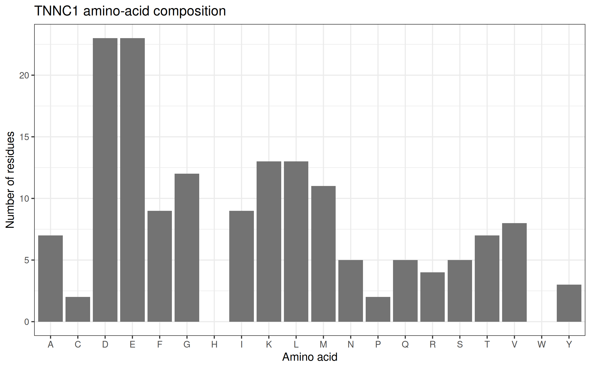
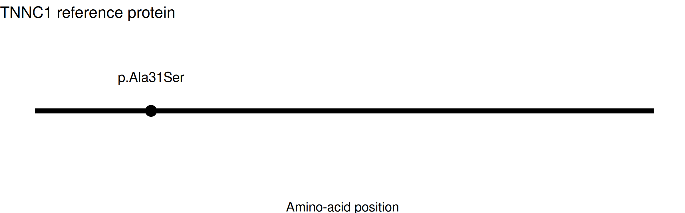
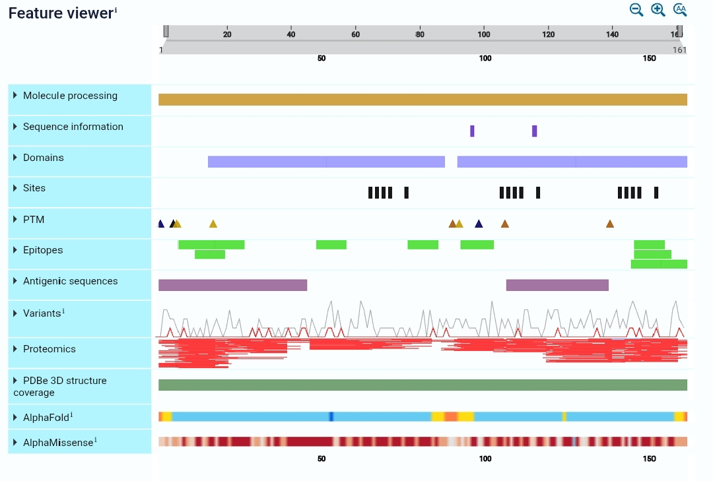

# Muscle-Contractility-TNNC1

## (a) Assignment
- Assignment number: 16
- Gene: TNNC1 (troponin C1, slow skeletal and cardiac type)
- Transcript: NM_003280.3
- Variant: c.91G>T (p.Ala31Ser)
- ClinVar Variation ID: 39832
- NCBI Gene ID: 7134
- Protein: NP_003271.1

## (b) Research question
How might the A31S change in cardiac troponin C affect calcium sensing in the thin filament, and what does the evidence say about its link to cardiomyopathy?

## (c) Methods
1. Made the project folder Muscle_Contractility_TNNC1 with data, results and figures subfolders. I used Posit Cloud (RStudio in a browser) because I worked from a phone.
2. Installed the packages with install.packages(c("rentrez", "ggplot2")) and loaded them with library().
3. Searched NCBI Gene for TNNC1 in humans (txid9606) with entrez_search(), then checked the exact gene symbol with entrez_summary().
4. Downloaded the transcript NM_003280.3 with entrez_fetch(db = "nuccore"), pulled out the NP_ accession, and downloaded the protein FASTA with entrez_fetch(db = "protein").
5. Counted the 20 standard amino acids, saved the table as a CSV, and made a bar chart with ggplot2 and ggsave().
6. Opened ClinVar record 39832 and wrote down the classification, review status, submissions and citations.
7. Made a variant position plot in R, and took a screenshot of the UniProt Feature viewer for the domain figure.
8. Saved the R session details with sessionInfo().
- Errors I corrected: none in the final run. The script ran from start to finish with no error messages.

## (d) Results and figures
- NCBI Gene ID: 7134
- Official name: troponin C1, slow skeletal and cardiac type
- Chromosome: 3
- Protein accession: NP_003271.1
- Protein length: 161 amino acids
- Residue 31 in the FASTA is alanine (A), which matches p.Ala31Ser.
- Most common amino acids: aspartate (23) and glutamate (23), then a tie between lysine (13) and leucine (13).

Figure 1. Amino-acid composition of NP_003271.1 (made in R).

Figure 2. The marker shows p.Ala31Ser at residue 31 of 161 in NP_003271.1 (made in R).

Figure 3. UniProt Feature viewer for TNNC1 (P63316), accessed 27 October 2026. Residue 31 lies in EF-hand 1 (positions 16-51). Source: UniProt.

## (e) Variant interpretation (ClinVar record, accessed 27 October 2026)
- Variant type: single nucleotide variant, missense (alanine to serine at residue 31).
- Aggregate classification: Pathogenic.
- Review status: 1 star.
- Submissions: two are listed. Labcorp Genetics (formerly Invitae), last evaluated 21 July 2023, is the only one counted toward the aggregate classification. OMIM, last evaluated 14 September 2012, is literature-based and is not counted.
- Conditions: hypertrophic cardiomyopathy 13, and a second record that lists dilated cardiomyopathy 1Z together with hypertrophic cardiomyopathy 13. For that second record, ClinVar says the explanation for multiple conditions is uncertain.
- Publications cited by ClinVar: Parvatiyar et al. 2012 and Vasilescu et al. 2018.
- Notation: the genomic HGVS reads C>A and the transcript HGVS reads G>T. They describe the same change, because TNNC1 is on the opposite strand.
- Population data: ClinVar lists no allele frequency, and the Labcorp comment says the variant has no frequency in gnomAD.
- ClinVar classifications can change over time. I kept my assigned variant.

## (f) Limitations and validation experiment
- The clinical evidence is thin. It comes mostly from one child, and the aggregate classification rests on one submission with a 1-star review.
- The lab experiments used purified proteins and skinned fibers, not living human heart tissue.
- The PolyPhen-2 result is a computer prediction, not a measurement.
- Validation experiment: measure force against calcium concentration in skinned heart muscle cells carrying A31S, and image calcium transients in heart muscle cells with the variant. This would test the higher calcium sensitivity and the possible link to arrhythmia.

## (g) Database links, access dates and references
Database links (all accessed 27 October 2026):
- NCBI Gene: https://www.ncbi.nlm.nih.gov/gene/7134
- NCBI Protein, NP_003271.1: https://www.ncbi.nlm.nih.gov/protein/NP_003271.1
- NCBI Nucleotide, NM_003280.3: https://www.ncbi.nlm.nih.gov/nuccore/NM_003280.3
- ClinVar: https://www.ncbi.nlm.nih.gov/clinvar/variation/39832/
- UniProt P63316: https://www.uniprot.org/uniprotkb/P63316

References:
1. Parvatiyar MS, Landstrom AP, Figueiredo-Freitas C, Potter JD, Ackerman MJ, Pinto JR. A mutation in TNNC1-encoded cardiac troponin C, TNNC1-A31S, predisposes to hypertrophic cardiomyopathy and ventricular fibrillation. J Biol Chem. 2012;287(38):31845-55. PMID: 22815480. doi:10.1074/jbc.M112.377713
2. Rayani K, Hantz ER, Haji-Ghassemi O, Li AY, Spuches AM, Van Petegem F, Solaro RJ, Lindert S, Tibbits GF. The effect of Mg2+ on Ca2+ binding to cardiac troponin C in hypertrophic cardiomyopathy associated TNNC1 variants. FEBS J. 2022;289(23):7446-7465. PMID: 35838319. doi:10.1111/febs.16578
3. Vasilescu C, et al. Genetic Basis of Severe Childhood-Onset Cardiomyopathies. J Am Coll Cardiol. 2018. PMID: 30384889 (cited by ClinVar for this variant).
4. Karp et al., Cell and Molecular Biology (course textbook), Chapter 9.

## How to rerun this work
1. Install R and RStudio, or use Posit Cloud in a browser.
2. Run install.packages(c("rentrez", "ggplot2")) once. This line is already at the top of analysis.R.
3. Open analysis.R and run the whole script (Source). It creates the data, results and figures folders and saves all outputs.
4. NCBI can limit repeated requests. If a step fails, wait a minute and rerun it. Do not change the gene or variant.

## Questions

**1. What does TNNC1 encode, and how does this protein contribute to muscle function?**
TNNC1 encodes troponin C, the calcium sensor of the troponin complex on the thin filament in heart muscle and slow skeletal muscle. When calcium binds, troponin C changes shape and the thin filament shifts so that myosin can bind actin and the muscle contracts. When calcium levels fall, the filament switches off and the muscle relaxes.

**2. What was the exact protein accession and length retrieved with R?**
NP_003271.1, which is 161 amino acids long. R got it from the transcript NM_003280.3.

**3. What did the amino-acid composition chart show? What can it NOT tell you?**
Aspartate and glutamate were the most common (23 each), followed by a tie between lysine and leucine (13 each). The large number of acidic residues fits a calcium-binding protein. But composition cannot show where residues sit, how the protein folds, or what A31S does.

**4. What is the fixed ClinVar variant, and what is its current classification and evidence strength?**
NM_003280.3:c.91G>T (p.Ala31Ser), ClinVar 39832. It is classified Pathogenic with a 1-star review status. Only one submission counts toward that classification, so the evidence is limited.

**5. What is the supported mechanism, and what remains uncertain?**
Lab studies found that the mutant troponin C makes the thin filament more sensitive to calcium. This could change how the heart relaxes. It is still uncertain whether this directly causes disease, and how a change in EF-hand 1 passes its effect to the calcium-binding site that controls contraction.

**6. What additional experiment would help test the mechanism?**
Force against calcium measurements in skinned heart muscle cells carrying A31S, together with calcium imaging in living heart muscle cells.

## Discussion: experimental, clinical and predicted evidence

The strongest evidence about A31S comes from experiments in the 2012 paper by Parvatiyar and colleagues. They put the mutant troponin C into pig heart muscle fibers that had their own troponin C removed. The fibers became more sensitive to calcium, but the maximum force did not change. In reconstituted actomyosin ATPase assays, the mutant increased the activation of the ATPase without affecting its inhibitory qualities. Fluorescence studies showed higher calcium affinity in isolated troponin C, in the troponin complex, and in the thin filament. Circular dichroism did not show a global change in structure. A 2022 study by Rayani and colleagues used isothermal titration calorimetry and found that A31S raises the affinity for both calcium and magnesium. These are measurements, so they count as experimental evidence. They were done on purified proteins and skinned fibers, not in living human hearts.

The clinical evidence is weaker. The 2012 paper described one child who was diagnosed with hypertrophic cardiomyopathy at age 5 and had several episodes of ventricular fibrillation and aborted sudden cardiac death. The child's family history was negative for hypertrophic cardiomyopathy and sudden cardiac death, which suggests the change appeared de novo. The variant was not found in more than 26,600 reference alleles. ClinVar lists it as Pathogenic, but only one submission counts toward that, and it has a 1-star review. A second record links the variant to dilated cardiomyopathy, and ClinVar describes the explanation for multiple conditions as uncertain. So the link to disease is real, but it rests on very few cases.

The prediction evidence is the PolyPhen-2 result mentioned in the Labcorp submission, which says the variant is likely to be disruptive. This is a computer prediction, not a measurement, so I treat it as supporting evidence only. The 2022 paper also used thermodynamic integration simulations, which are computational too.

Putting this together, my causal chain is: TNNC1 encodes troponin C, which senses calcium, and A31S sits in EF-hand 1 (positions 16-51 in UniProt). Experiments show the change raises calcium sensitivity. A thin filament that switches on at lower calcium could change relaxation and might affect heart rhythm. The authors suggest this may explain the arrhythmia in the child, but they do not prove it.

Some things are still uncertain. The protein studies do not show what happens in a living human heart. I also do not know how a change in EF-hand 1 affects calcium binding at the regulatory site. Having only one clear patient also makes it hard to say how strong the disease risk is. A force and calcium experiment in cells carrying A31S, plus calcium imaging, would be a good next test.
